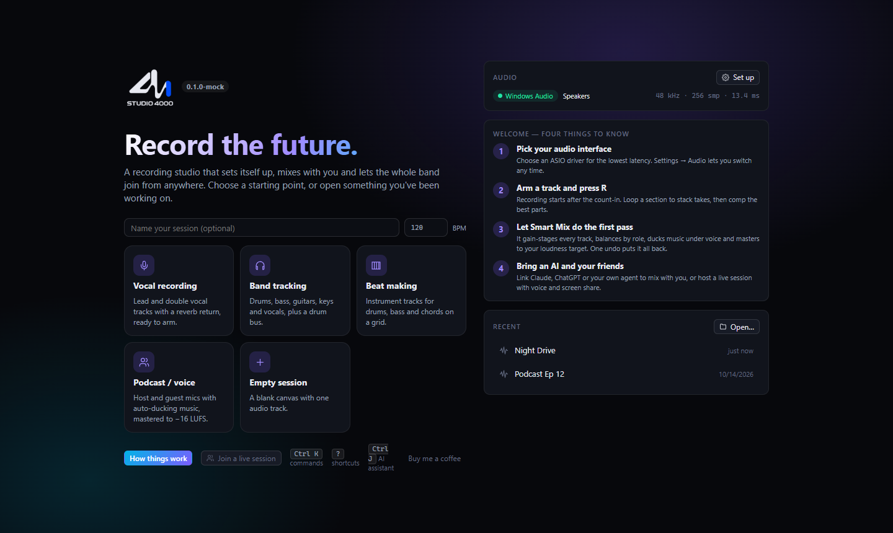
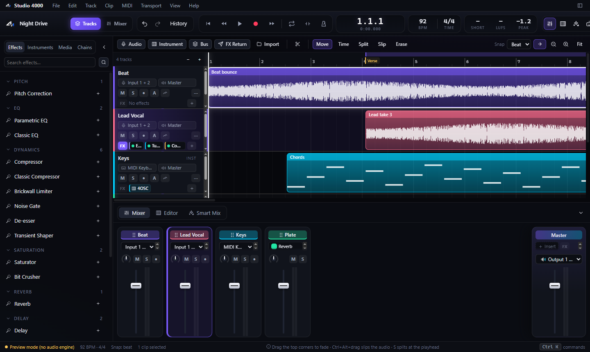
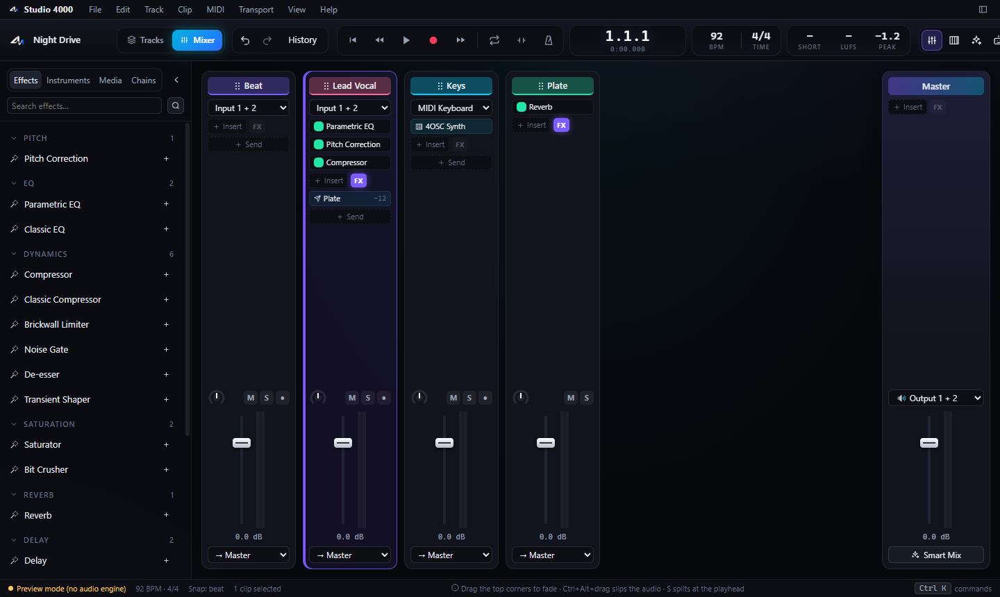

# Studio 4000

Built Studio 4000 from scratch because making music should not start with a subscription.

Studio 4000 is a vibe-coded DAW, and it is fully free to use. Record, arrange, mix, and play with someone else, on your own Windows computer. Fully free means the songs you release too: there is no fee, no account, and the music you make is yours. If you are here to create, welcome in. Wishing the best to every artist, producer, and band who opens it.

When a song is ready to meet people, take it to [AKAsheet](https://akasheet.com/?ref=studio4000). It is a new social place where artists can share and sell their music, discover other artists, and connect. It also has a smart notebook with AI tools and pathways. The same mark sits in the top bar, just before search.

If Studio 4000 is useful, you can [buy me a coffee](https://buymeacoffee.com/b4bdev). That is optional. The app stays free either way.

Found a bug, or have an idea? Write to [akasheet.support@gmail.com](mailto:akasheet.support@gmail.com). The same link is under Help inside the app. Everything is still being tested and suggestions and feedback are highly welcomed.







## Features

- Audio, instrument, bus, and FX-return tracks, with a mixer whose faders stay the same height
- Loop recording, takes, comping, clip nudge, and Move, Time, Split, Slip, and Erase tools
- Built-in instruments, a piano roll, and computer-keyboard playing
- Built-in effects, including a parametric EQ with a real spectrum, plus Airwindows and your own VST3 plug-ins
- Several effect windows open at once, drag-to-reorder tracks and effects, and a named undo history
- Smart Mix on this computer: gain, balance, vocal ducking, and a loudness target, as one undo step
- An assistant that stays off until you add your own model key. Studio 4000 does not charge for that key
- Live sessions with a room code, voice, and screen share. The app hosts the connection; send the code and the other person joins
- An in-app guide: Help → How Studio 4000 works

## Use it

The built app is a folder with `Studio 4000.exe` inside. Run that file, or the Start-menu shortcut after `.\tools\package.ps1 -Install`.

If you are online, the app checks the public project every time it opens and updates itself when a newer build is published. Help → Check for updates does the same thing on demand, and Help → What's new shows the version and the notes. A push to the main branch publishes that build. This applies to the installed app and to a copy unzipped from a published build.

To hand someone a copy, zip that whole folder and send it. They unzip it and run the exe. Having the file does not put them in your session. Both people open the app, one hosts, and the other joins with the room code.

The longer guide is [docs/HOW-TO.md](docs/HOW-TO.md): first session, sharing a copy, recording, mixing, the assistant, live sessions, and how to build.

## Build

Windows, Visual Studio 2022 with the C++ workload, CMake, and Node.js 18 or newer.

```powershell
.\tools\fetch-deps.ps1
.\build.ps1
.\tools\package.ps1 -Install
```

`fetch-deps.ps1` clones [Tracktion Engine](https://github.com/Tracktion/tracktion_engine) at the commit this app is written against and applies one small monitor patch. The ASIO SDK and the WebView2 package are not in this repository. The script tells you where to put them. Details are in the how-to.

## Notices

- [LICENSE](LICENSE) — free use of the app, and what that does not cover
- [DISCLAIMER.md](DISCLAIMER.md) — no warranty, trademarks, and what the app is not
- [PRIVACY.md](PRIVACY.md) — projects, keys, and live sessions stay where you put them
- [NOTICE.md](NOTICE.md) — JUCE, Tracktion Engine, Airwindows, SoundTouch, and the ASIO SDK

Studio 4000 is operated by COMMODIOUS WORKS LLC.

© 2026 COMMODIOUS WORKS LLC. All rights reserved.

Studio 4000 was built from scratch. It is not made by Steinberg, JUCE, Tracktion, or Airwindows. VST is a registered trademark of Steinberg Media Technologies GmbH. ASIO is a trademark of Steinberg.

## Tip

[buymeacoffee.com/b4bdev](https://buymeacoffee.com/b4bdev)
